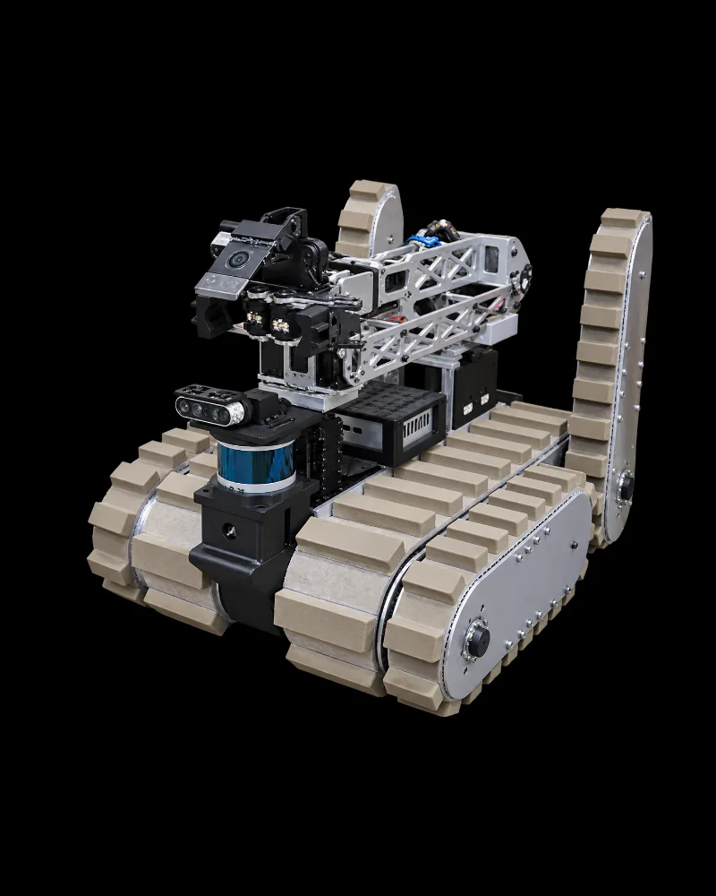

## 대회 개요

- **대회명**: 2025 극한로봇 경진대회
- **대회일시**: 2025. 09. 30(화) ~ 2025. 10. 02(목) (3일간)
- **대회장소**: 서울 코엑스 2층(서울 강남구 삼성동 소재)
- **주최**: 서울시, 서울경제진흥원
- **주관**: 한국로봇융합연구원
- **후원**: 한경닷컴, 에프알티로보틱스
- **대회종목**: 극한로봇 부문
- **참가자격**: 학교, 기업, 연구소에 소속된 개인 또는 단체(팀)
- **시상규모**: 서울시장상, 서울경제진흥원대표이사상 등 총 2,500여만원 수여

## 로빛의 참가

- 2025년 처음 열린 극한로봇 경진대회에 Eclipse로 출전해 1위(대상, 서울시장상)를 수상했습니다.
- 관련 보도는 [언론 보도](/articles/press)에서 볼 수 있습니다.

## ROBOT

- **Eclipse** — Intelligence Robot Team

