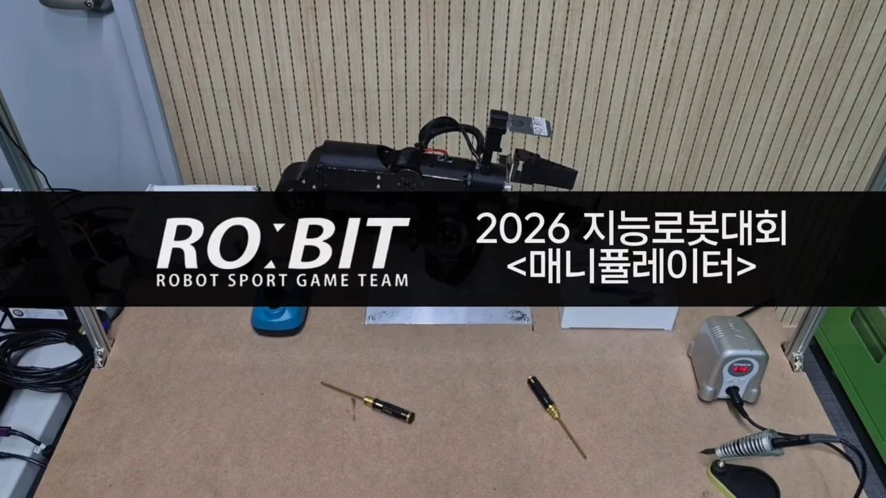

## Overview

**SAFE LAB**은 실험실에 사람이 남겨 둔 위험 요소를 스스로 찾아 정리하는 자율 로봇입니다. 2026년 지능형 로봇 경진대회(IRC) 매니퓰레이터 종목에 출전해 2위를 수상했습니다.

[▶ 시연 영상 보기](https://youtu.be/OLy96QEyY1U) · [제작 이야기](https://team-robit.github.io/irc-mani-web/)

## Hardware

팀에서 직접 설계하고 가공·조립했습니다.

| 구분 | 사양 |
| :--- | :--- |
| 팔 | 7-DOF, QDD(Quasi-Direct Drive) |
| 가반하중 | 정격 3 kg · 최대 5 kg |
| 도달 거리 / 무게 | 77 cm · 7.3 kg |
| 제어 | 자체 제작 저수준 모터 컨트롤러 |
| 센싱 | RGB-D · 열화상 · 손목 카메라 |
| 연산 | Jetson AGX + RTX 4060 노트북 |

## 과제 성공률

| 과제 | 성공률 |
| :--- | ---: |
| 위험 요소 식별 (Hazard identification) | 98.5% |
| 납땜 인두 플러그 뽑기 (Soldering-iron unplug) | 92% |
| 배터리 분리 (Battery removal) | 92% |
| 작업대 정리 (Workbench tidy-up) | 80% |
| 멀티탭 끄기 (Power-strip off) | 70% |

## Software

| 구성 | 사용 기술 | 역할 |
| :--- | :--- | :--- |
| VLM | Qwen3-VL-4B | 작업 계획 |
| 모방 학습 | ACT on LeRobot | 스킬 실행 |
| 비전 | YOLO11n · SAM 2.1 | RGB-D + 열화상 인식 |
| 모션 플래너 | MoveIt 2 · pick_ik | ROS 2 Jazzy |

## 제작

- 김민조 — 컨트롤러 · 모방 학습 · 플래너
- 우정윤 — 팔 설계 · 가공
- 박기홍 — 배선 · 시연 세팅 · 웹
- 송수민 — VLM · 비전
