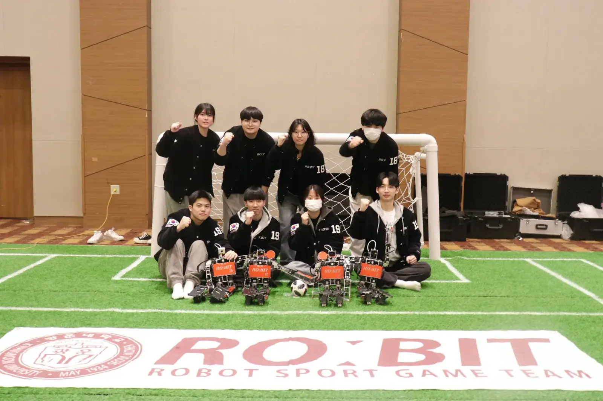
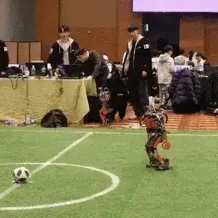

## Introduction

RoboCup Soccer 종목은 Kid Size의 휴머노이드 로봇들이 축구 경기를 자율적으로 수행하는 대회입니다.

로봇은 카메라, IMU, 적외선 센서 등을 활용해 주변 환경을 인식하고, 외부 조작 없이 공을 찾아 패스와 슈팅을 통해 경기를 진행합니다. 각 팀은 로봇의 하드웨어와 소프트웨어를 직접 개발하고, 팀 전략에 맞춘 알고리즘을 설계해 경기에 참여합니다.

## Robot

2022 Robocup Humanoid Soccer Team.RO:BIT

### 2022년도 결과

- 2022년 RoboCup Korea Open Soccer Humanoid 1위
- 2022년 RoboCup Bangkok Humanoid Kid Size Drop In 3위
- 2022년 RoboCup Bangkok Humanoid Kid Size Technical Challenge 2위
- 2022년 RoboCup Bangkok Humanoid Kid Size Main Competition 4위

## Specifications

| 항목 | 구분 | 내용 |
| :--- | :--- | :--- |
| ROBOT NAME | | Blankie |
| SIZE | Weight | 6.38 kg |
| SIZE | Height | 596.5 mm |
| DOF | All | 20 DOF |
| DOF | Head | 2 DOF |
| DOF | Leg | 12 DOF |
| DOF | Arm | 6 DOF |
| Actuators | | ROBOTIS Dynamixel |
| Computing units | | NUC10i5FNK & STM32 |
| Camera | | C920R Logitech |
| Sensors | | EBIMU-9DOFV5 |
| Walking speed | | 18 cm/s |
| Battery | | Li-Po 4Cell 4000mAh |
| OS | | Ubuntu 18.04 |

## Walking

로봇의 보행은 12개의 자유도를 가진 양다리의 역기구학을 기반으로 수행됩니다. 각 다리의 끝을 end effector로 설정하고, 골반 중심을 기준으로 각 모터의 각도를 결정합니다. 이 모터 각도는 end effector의 좌표 변화에 따라 실시간으로 조정됩니다.

보행 중 다른 로봇과의 충돌이나 불안정한 환경에서도 형을 유지하기 위해, IMU 센서를 활용해 PID 제어와 피드백 시스템을 통해 보행 안정성을 높였습니다.

또한, 로봇의 발에는 4개의 load cell이 장착되어 있어 COP를 측정합니다. 이 데이터를 바탕을, ZMP가 지지다각형 내에서 유지되도록 PID 제어를 적용해 목표 ZMP에 도달하도록 보정합니다.

안정적인 보행은 축구 경기의 전체적인 성과에 직결되므로, 최대한 안정적이고 빠른 보행을 구현하는 것을 목표로 하고 있습니다.
