## Introduction

RoboCup Rescue는 재난 환경에서 수색과 구조 임무를 수행할 수 있는 지능형 로봇을 개발하고 평가하는 대회입니다.

피해자 수색, 장애물 극복, 물체 인식, 경로 계획 등에서 로봇의 성능과 자율성을 입증해야 하며, 다중 로봇 협력과 오퍼레이터와의 통신 능력도 평가됩니다. 이 대회는 재난 대응에 실질적으로 적용 가능한 로봇 기술을 발전시키는 것을 목표로 합니다.

## 2026 시즌 · Eclipse (인천)

- **결과**: 세미파이널 진출 (파이널 진출 실패)
- Eclipse로 출전했습니다.

### 팀과 함께

 — 교수님과 단원 모두 함께")

## 2025 시즌

- 대회가 브라질에서 열려 출전하지 못했습니다.

## ROBOT

- **Scue** (2021)
- **KUBO** (2022)
- **KULS** (2024)
- **Eclipse** (2026)

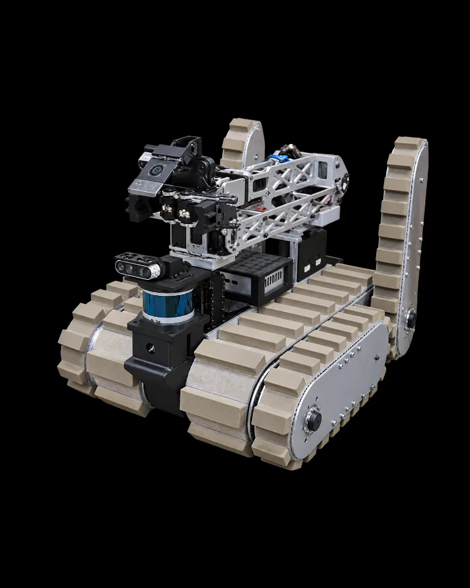

## Technology

- 4개의 플리퍼를 사용하여 계단 뿐만 아니라 다양한 지형을 돌파할 수 있습니다.

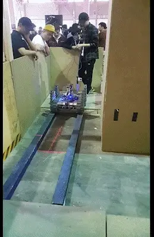

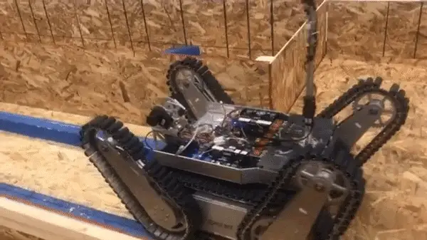

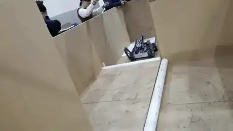

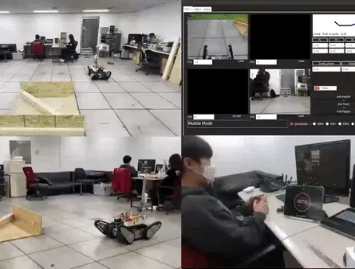

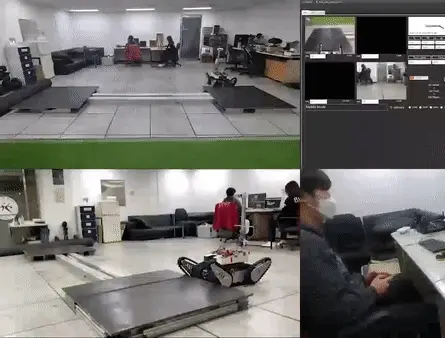

- 이미지 처리 기술을 통해 색상, 패턴, 동작 인식 등을 수행할 수 있습니다.

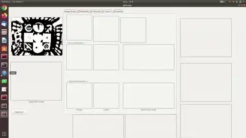

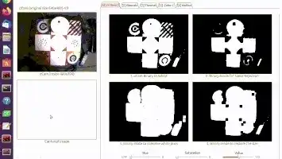

- 매니퓰레이터를 이용하여 물체를 들고, 옮기고, 작은 구멍에 넣는 등 다양한 미션을 수행할 수 있습니다.

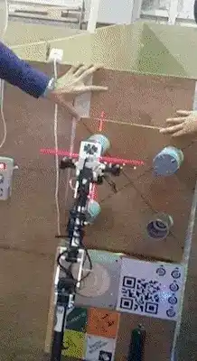

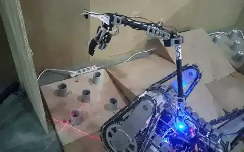

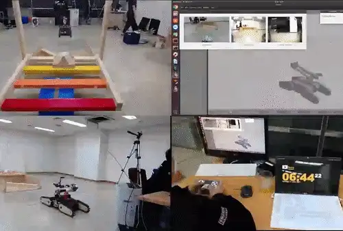

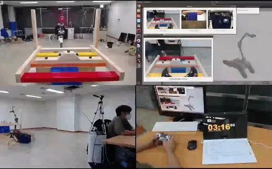

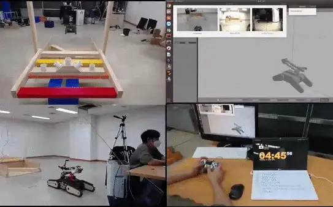

- IMU와 LiDAR를 이용하여 localization을 진행하고 map을 생성할 수 있습니다.

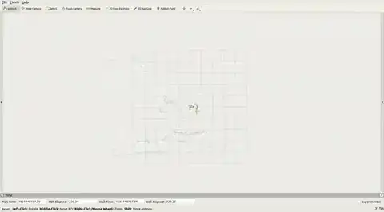
