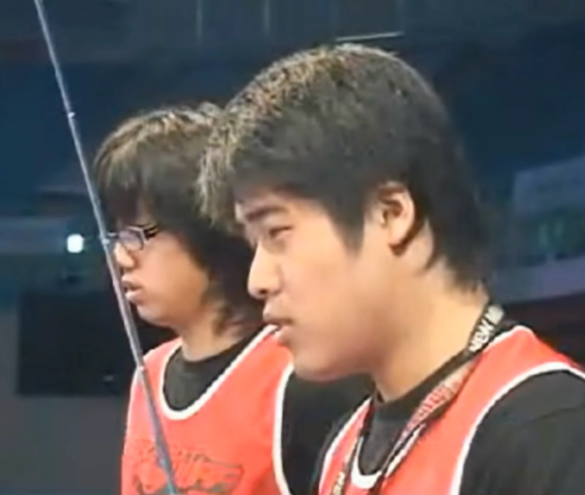
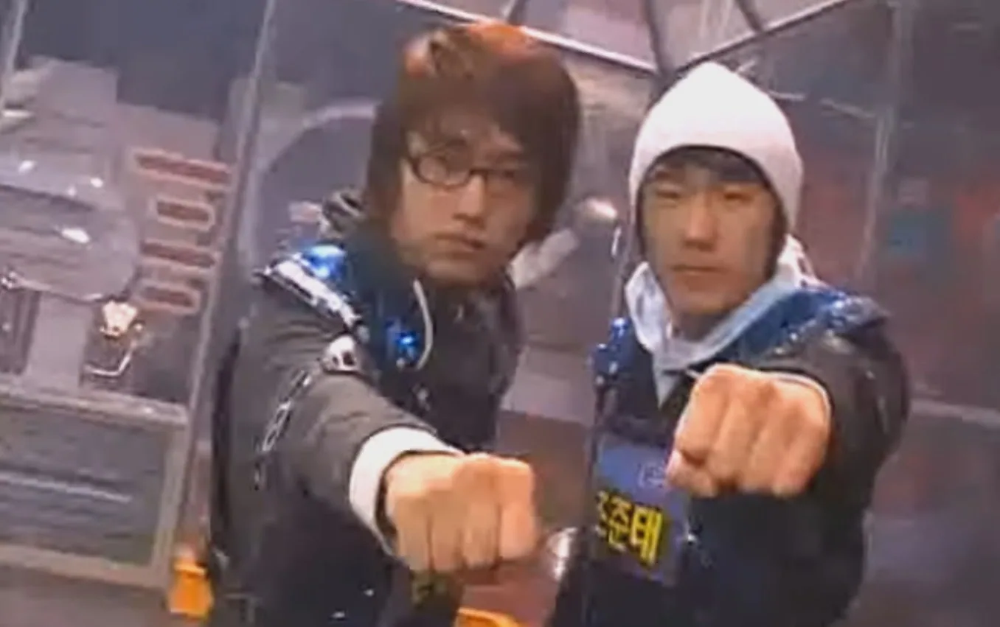
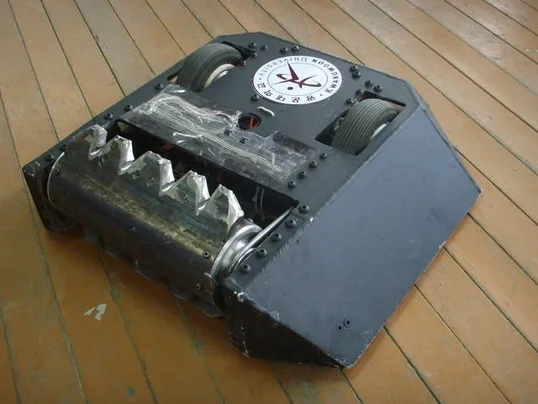
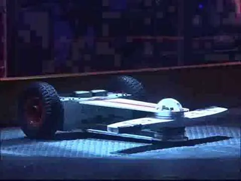
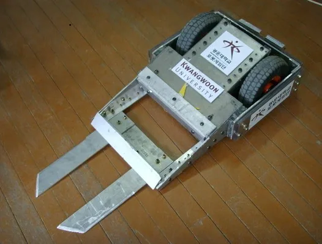
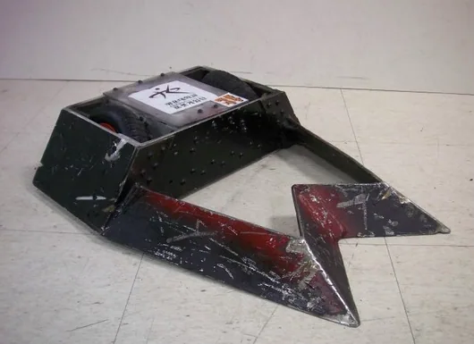
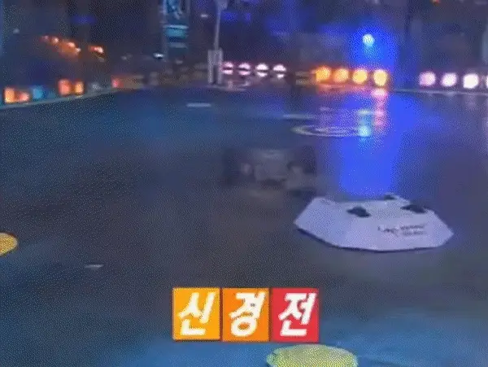
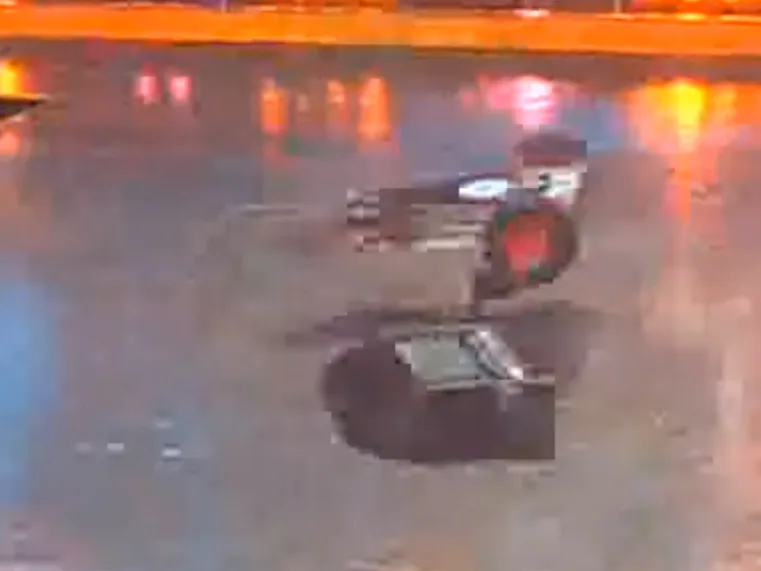
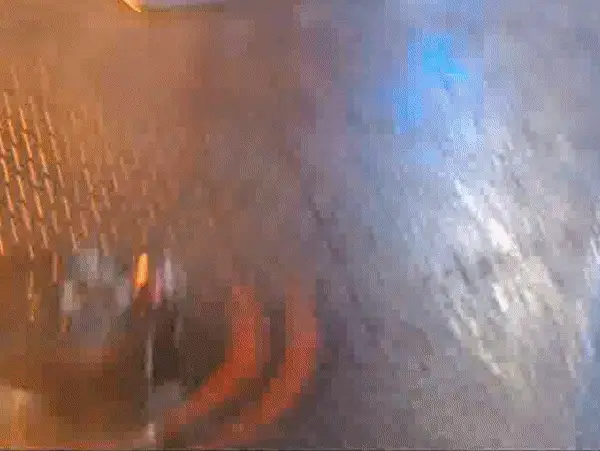

## 프로그램 소개

당시 EBS의 "로봇파워" 프로그램은 배틀로봇 종목을 중심으로 휴머노이드, 배틀로봇 축구, 주니어로봇 등 다양한 종목을 방영하며 국내 아마추어 로봇 제작자들에게 큰 동기를 부여하였고, 시청자들로부터도 높은 인기를 얻었습니다.

특히 로빛은 이 프로그램을 통해 다양한 배틀로봇을 개발하며 다수의 입상을 거두었고, 초창기 로봇 게임단으로서의 위상을 확립하는 데 큰 기여를 하였습니다.

그러나 시간이 지남에 따라 프로그램의 인기도와 시청률이 감소하고, 참여자 수도 줄어들면서 메인 이벤트였던 배틀로봇 경기가 폐지되었다. 이후 "대한민국 로봇대전" 등으로 그 명맥을 이어갔으나, 제8회 대한민국 로봇대전을 끝으로 EBS에서 주최하는 배틀로봇 경기는 완전히 종료되었습니다.

## 경기 방식

- 기본 경기 형식은 영국에서 방영되었던 로봇 워 프로그램에 토너먼트 형태를 합친 방식으로 진행되었으며 매 회 5팀이 출전한다.

- 두 배틀 로봇이 제한 시간 내에 상대 로봇을 함정으로 밀어넣거나, 상대방 로봇의 작동을 중지시키면 승리한다.

- 단, 함정에 빠지고 난 뒤 3초 이내에 빠져나올 경우에는 경고 1회와 함께 경기가 속행된다.

- 로봇이 작동 중지되거나 움직일 수 없는 경우 공격 중지 명령이 떨어지며 10초안에 로봇이 움직이지 못하면 패배한다.

- 한 쪽에는 심판 로봇이 위치해 심판 로봇으로 끌려온 로봇을 공격할 수 있고 그 외에 불기둥, 수직 펀치, 해머 등 다양한 장애물이 존재한다.

- 소극적인 경기 플레이, 정비 시간 초과, 함정에 빠지고 3초가 지나기 전 빠져나오는 등 비매너 플레이가 나왔을 시 경고가 부과되며 3회를 받게 되면 실격 처리된다.

- 제한 시간 내에 승부를 가리지 못한 경우에는, 심사위원들의 점수로 승패를 가린다.

- 만약에 동점이면 다시 한 번 재경기를 벌이고, 그래도 결판이 나지 않을 경우, 다시 심사위원들의 점수로 승패를 결정한다.

- 우승팀에게는 상금과 함께 최대 5연승에 도전할 수 있는 기회가 주어진다.(5연승에 성공하면 최대 1000만원) 5연승 성공시에는 명예의 전당에 이름을 올릴 수 있다.

- 만약 두 로봇이 동시에 묶여있어 두로봇 모두 움직이지 못할 시에는 심판로봇이 직접 로봇을 빼준다.

