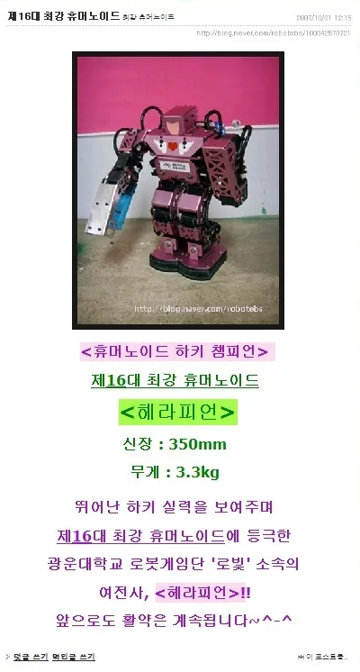
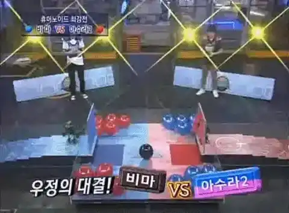
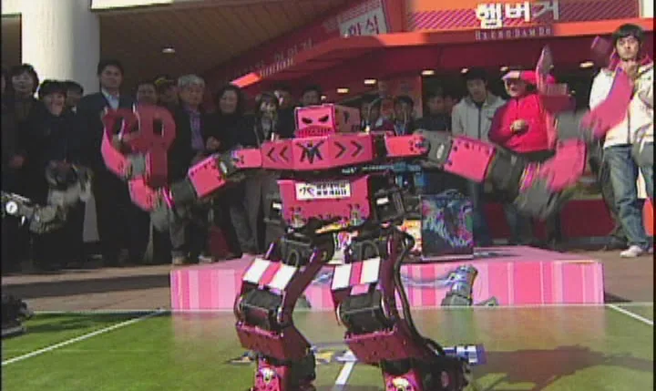
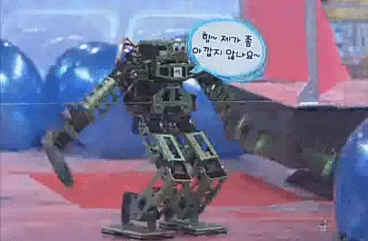
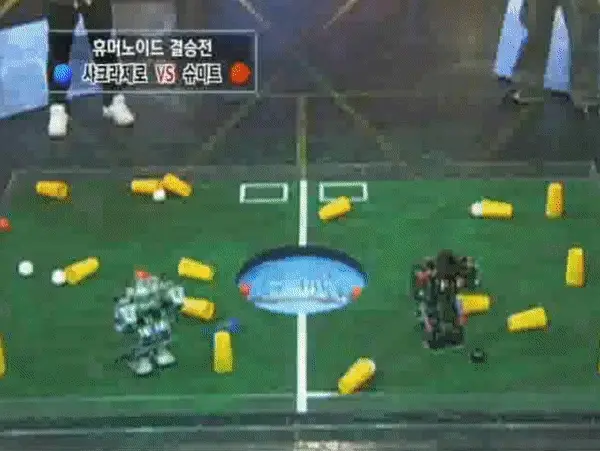

## EBS 로봇파워 - 휴머노이드

휴머노이드 조종형 경기로, 매 회차마다 달라지는 미션을 1 VS 1 경쟁 방식으로 치뤄 주차별 우승자를 결정합니다.

이후 주차별 우승자를 모아 그 미션의 최강자를 가리는 식으로 경기를 진행합니다.

주로 주어지는 미션은 휴머노이드를 이용한 풍선 터트리기, 공 넣기, 격투 등이 있었습니다.

당시 로빛 휴머노이드 팀 역시 자주 참여하여 좋은 성적을 보여주었습니다.

2007년 09월 04일 EBS 로봇파워 휴머노이드 16차 미션 주우승

2007년 10월 15일 EBS 로봇파워 휴머노이드 17대 최강 휴머노이드 등극

2007년 12월 12일 EBS 로봇파워 휴머노이드 왕중왕전 준우승

2009년 03월 21일 EBS 로봇파워 휴머노이드 미션 주우승

2009년 04월 11일 EBS 로봇파워 휴머노이드 미션 월장원 우승

2008년 04월 25일 EBS 로봇파워 휴머노이드 미션 주우승

2009년 07월 18일 EBS 로봇파워 휴머노이드 미션 월장원 우승

2010년 01월 23일 로봇파워 휴머노이드 미션 성공&우승

2010년 8월 28일 EBS 로봇파워 휴머노이드 격투 우승

외 총 17건의 입상 기록

