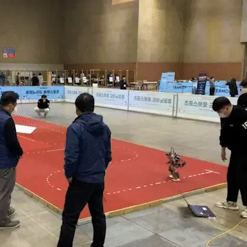
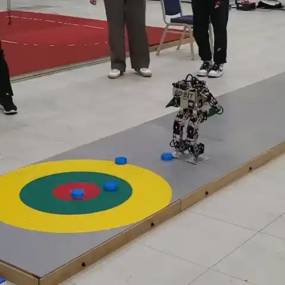
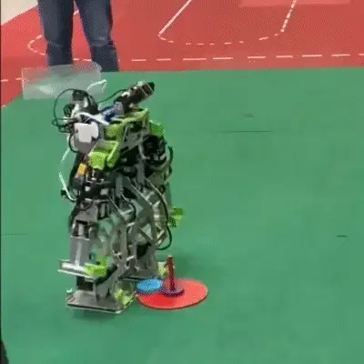
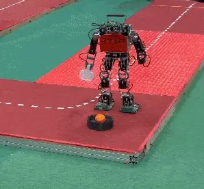
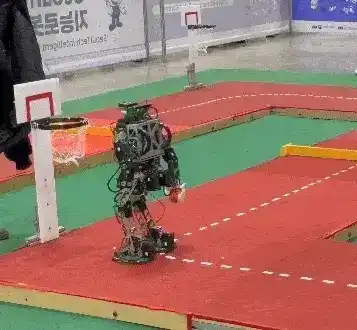

## SRCIRC Humanoid

### Robot

2024 SRCIRC에 참가한 로봇

SRCIRC 휴머노이드 로봇 스포츠 지능형 하이테크는 휴머노이드 플랫폼을 활용해 육상, 농구, 컬링, 하노이 등 다양한 스포츠 종목을 수행하는 대회입니다. 매년 종목이 무작위로 선정되거나 새로운 경기가 추가되기 때문에, 로보컵과 달리 기본적인 비전 및 보행 기술을 기반으로 매번 새로운 하드웨어와 소프트웨어를 개발해 대회를 준비합니다.

### 2026년도 결과

- 2026년 SRC·IRC 휴머노이드 로봇 스포츠 지능형 하이테크 부문 1위

### 2024년도 결과

- 2024년 SRCIRC 휴머노이드 로봇 스포츠 지능형 하이테크 부문 예선 1위
- 2024년 SRCIRC 휴머노이드 로봇 스포츠 지능형 하이테크 부문 1위
- 2024년 SRCIRC 휴머노이드 로봇 스포츠 지능형 하이테크 부문 2위

### Playing

종목: 육상 · 컬링 · 하노이 · 농구
