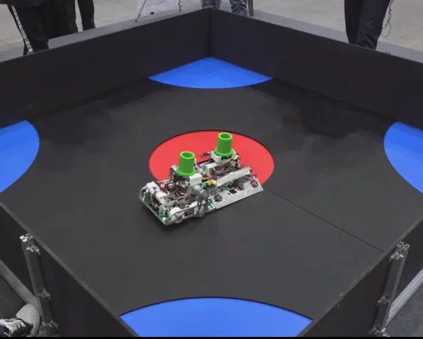
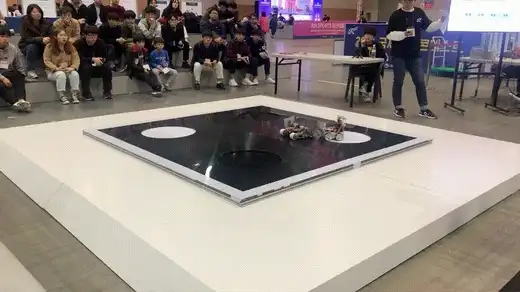
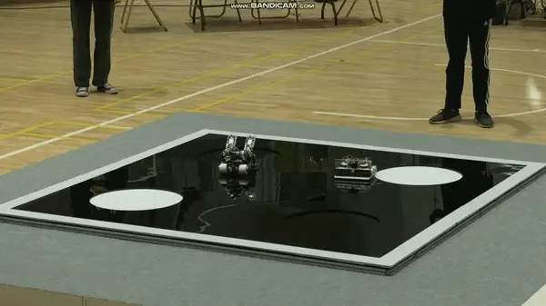
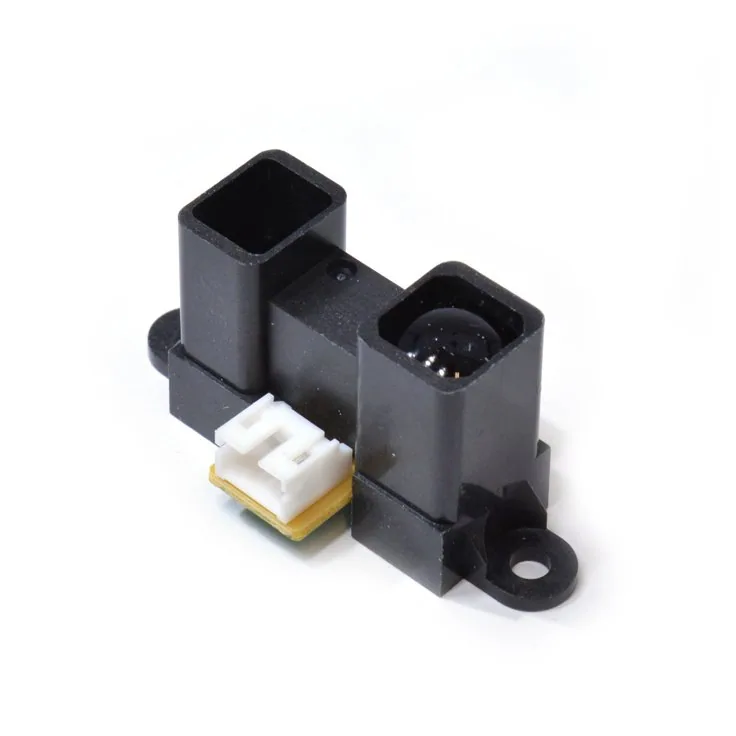
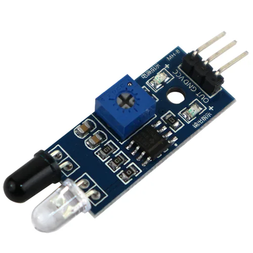
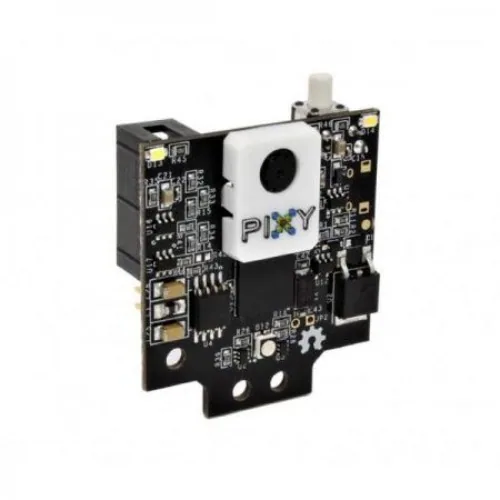

## SRCIRC 씨름로봇

SRCIRC 씨름로봇 대회는 서울과학기술대학교에서 주최하는 지능로봇 대회로, 경기장 내에서 자율적으로 서로를 감지하여 상대방을 먼저 밀어내는 로봇이 승리하는 대회입니다.

ROBIT은 2011년도부터 꾸준히 씨름로봇 대회에 참여해 왔으며,

2018년부터 2021년도까지 4연속 우승의 쾌거를 이루어내기도 하였습니다.

## 2026 시즌

- **결과**: 2위, 3위
- 2개 팀이 출전했습니다.

## 2025 시즌

- **결과**: 1위, 4위

## 사용된 기술

