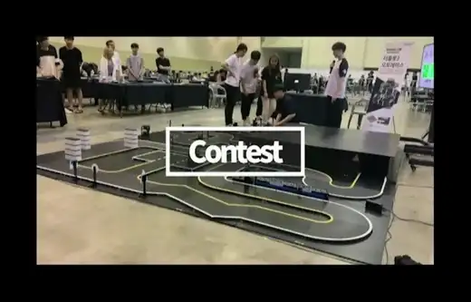
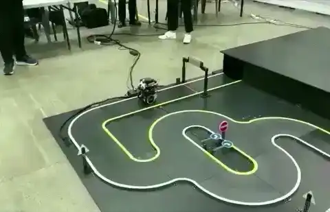
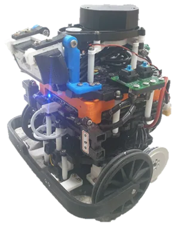
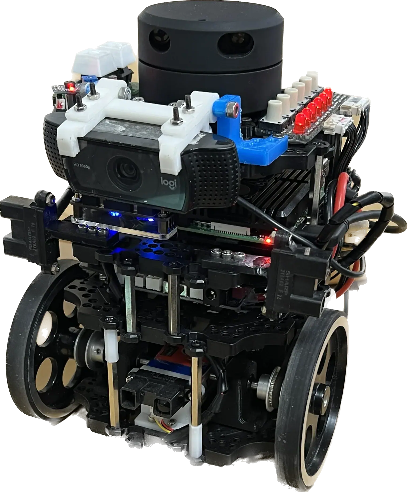
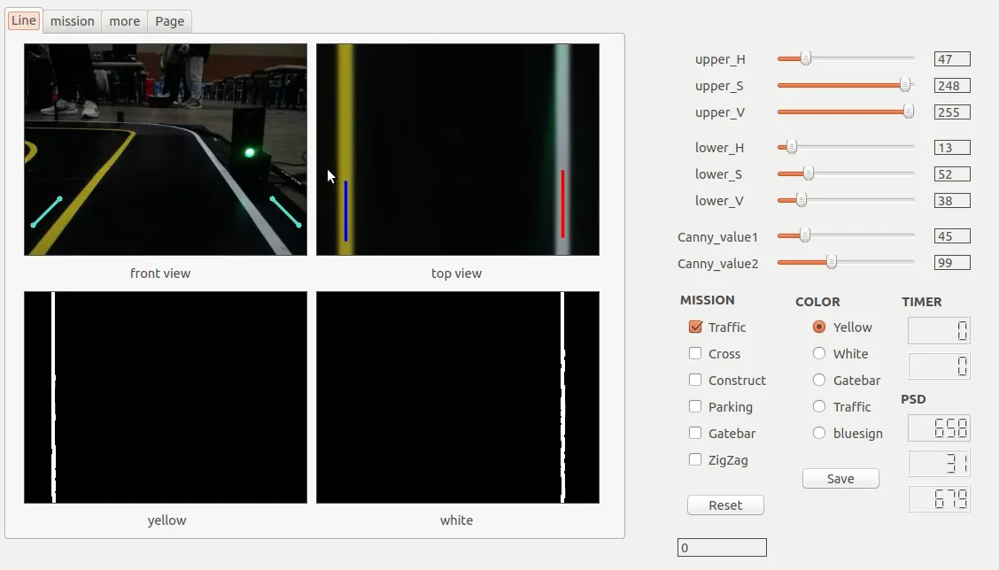
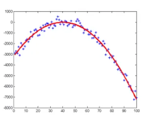
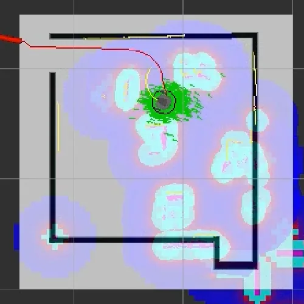

## TurtleBot3 AutoRace

-Robit Intelligent Robot Team-

Turtle Bot3 AutoRace 종목은 로보티즈에서 제공하는 터틀봇 플랫폼 혹은 ROS 소프트웨어에서 운용 가능한

모바일 플랫폼을 활용하여 자율주행 알고리즘을 개발하고 미션을 수행하는 종목입니다.

2019 Turtlebot3 Autorace Competition

2022 Turtlebot3 Autorace Competition

2019 Robit Turtlebot3 · 2022 Robit Turtlebot3

## 2025 시즌

- **결과**: 2위
- 2025년 대회까지 출전했습니다.

## Technology

카메라 정보를 활용해 차선이나 표지판 등을 인식해 미션을 수행합니다.

터틀봇 비전에서 차선 검출을 위한 알고리즘으로 RANSAC 알고리즘을 자체 제작하여 적용 중입니다.

ROS Navigation 오픈소스를 자체 수정하여 A* 전역 경로 생성 알고리즘과 DWA 지역 경로 생성 알고리즘을 기반으로 Robot Navigation을 구현하였습니다.
