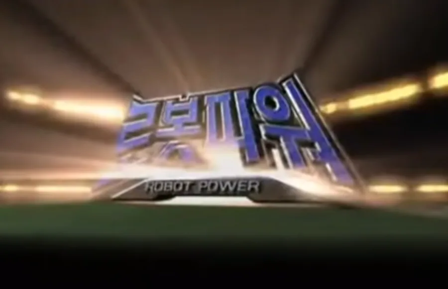
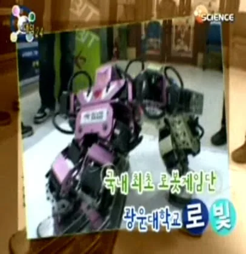
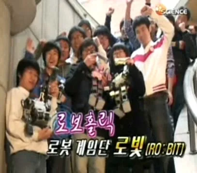
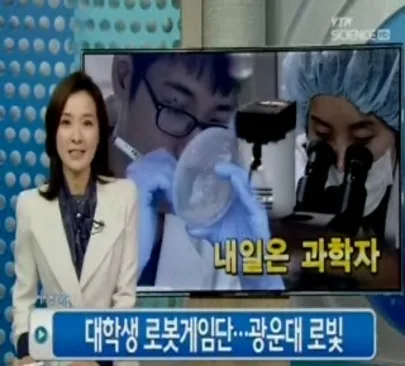

# 📺 출연 방송

## EBS 로봇파워

방영일자 : 2005년 9월 9일 ~ 2011년 2월 25일

로봇파워 프로그램의 배틀로봇 대회를 중심으로 참여하여 수 많은 유명 로봇을 배출한

로빛 배틀로봇 팀의 노력이 담겨있는 프로그램

## YTN 사이언스-대덕 24

- [연구소 24時- 국내최초 로봇 게임단,광운대학교 로빛](https://science.ytn.co.kr/program/view.php?mcd=1019&key=200802111418385036)

방영일자 : 2008년 2월 11일

국내 최초 로봇 게임단인 광운대학교 로빛을 알리고,

휴머노이드 로봇의 제작 과정을 설명한다.

로봇에 살고 로봇에 죽는 열혈 로봇사랑 로빛이 전하는

로봇에 대한 꿈과 희망 'I am 로봇'에서 만나본다.

## YTN 사이언스-I AM 로봇

- [로보홀릭, 로봇 게임단 로빛](https://science.ytn.co.kr/program/view.php?mcd=1011&key=200803031056556665)

방영일자 : 2008년 3월 3일

무적의 로봇전사 배틀로봇팀과 사람들에게 감동을 주는 휴머노이드팀,

로봇에 살고 로봇에 죽는 열혈 로봇사랑 로빛이 전하는

로봇에 대한 꿈과 희망 'I am 로봇'에서 만나본다.

## YTN 사이언스-사이언 24

- [대학생 로봇게임단, 광운대 로빛](https://science.ytn.co.kr/program/view.php?mcd=0030&key=201203300953127952)

방영일자 : 2012년 3월 30일

무적의 로봇전사 배틀로봇팀과 사람들에게 감동을 주는 휴머노이드팀,

로봇에 살고 로봇에 죽는 열혈 로봇사랑 로빛이 전하는

로봇에 대한 꿈과 희망 'I am 로봇'에서 만나본다.

## [SBS 모닝와이드 SOTY, 천만원을 잡아라](https://www.facebook.com/share/v/LNnxugpyJVbCvxAm/)

방영일자 : 2014년 1월 14일

2014년 당시 열린 소치 동계올림픽에 출전하는 대한민국 선수들을 응원하기 위해서 출연한 프로그램.

아이스링크장에서 직접 쇼트트랙과 아이스하키와 같은 종목을 휴머노이드 로봇을 활용해서 시연한다.

<iframe class="w-full aspect-video rounded-xl" src="https://www.youtube.com/embed/Mje5GhOt0XE" title="방송 영상" loading="lazy" allowfullscreen></iframe>

## 2014. 2. 15. SBS 놀라운 대회 스타킹

방영일자 : 2014년 2월 15일

위와 마찬가지로 동계올림픽 종목들을 시연함과 동시에 김연아의 우아한 동작들을 재현하는 김연아 로봇

그리고 걸스데이의 Something과 AOA의 짧은 치마, GOT7의 Girls Girls Girls 3가지 댄스로 풍부한 퍼포먼스를 선보인다.

<iframe class="w-full aspect-video rounded-xl" src="https://www.youtube.com/embed/niLD56OeUrg" title="방송 영상" loading="lazy" allowfullscreen></iframe>

## EBS 로봇 X 드론 챌린지

방영일자 : 2018년 1월 13일

'사람을 닮은 로봇'을 주제로 휴머노이드 댄스 퍼포먼스를 선보인다.

로봇으로 변신하는 라디오라는 신선한 아이디어가 돋보였던 방송
