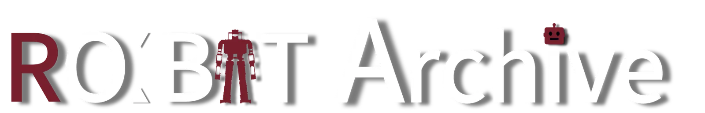

광운대학교 로봇게임단 로빛의 역사를 기록하고 업적을 기념하기 위해 시작된 로빛 창단 16주년 기념 프로젝트입니다.

### 로빛은 ROBOT,

### 광운대학교 인재상인 IT,

### 광운대학교 교육이념인 참빛을 합성해 탄생한

### 국내 최초 로봇 스포츠게임단입니다.

### 로빛의 주된 활동은 로봇 개발 및 연구입니다.

### 매년 16~24명의 단원들이 휴머노이드 로봇, 지능형 로봇 등

### 다양한 플랫폼의 로봇 개발을 위해 연구하고 있습니다.

### 팀원들은 각자 파트를 맡아 하나의 로봇을 함께 개발하고,

### 팀워크를 다지며 함께 성장합니다.

### 로빛은 개발한 로봇들로 국내외 다양한 대회에 참가해

### 우수한 성과를 거두며, 광운대학교와 로빛의 이름을 널리

### 알리기 위해 노력하고 있습니다.

[▶ contest](/contest/participation)

로봇의 대중화를 위해 다양한 로봇과 함께 지역축제와 K-Robot 대회 등

여러 대외 활동에 적극 참여하여 많은 학생들의 참여를 독려하고 있습니다.

### 또한, 다수의 방송 출연을 통해 대중의 큰 관심을 받고 있습니다.

### [▶ event](/events/participation)s

로빛 아카이브는 로빛 창단 16주년을 기념하여 시작된 아카이빙 프로젝트입니다.

2006년 창단 이래 로빛이 참여한 대회, 행사, 방송 출연 등의 기록을

하나의 사이트에 통합하여 많은 분들이 로빛에 대해 쉽게 알 수 있도록

정리하는 것이 목적입니다.
