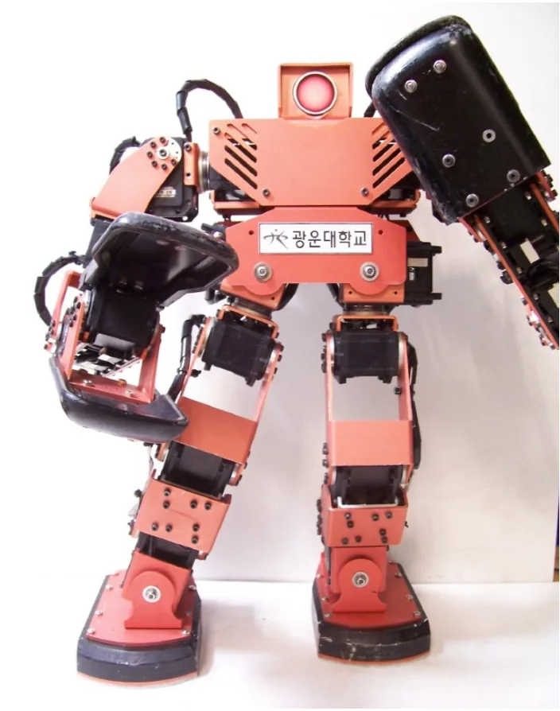

## 미스터(Mr)

Humanoid (Remote Control Type)

로빛 초창기인 2007년경에 활동한 휴머노이드 중 하나, 미스터K 등의 발전형이 존재합니다.

Height: 42cm

Weight: 4.6KG

Pilot: 표윤석

2007년 EBS 로봇파워 13차 미션 주우승

2007년 제4회 대한민국 로봇대전 휴머노이드 은상

2007년 SRGP KT배 3위

2007년 제3회 아시아 로보원 중량급 3위

2007년 SRGP 시즌2 퍼포먼스 준우승

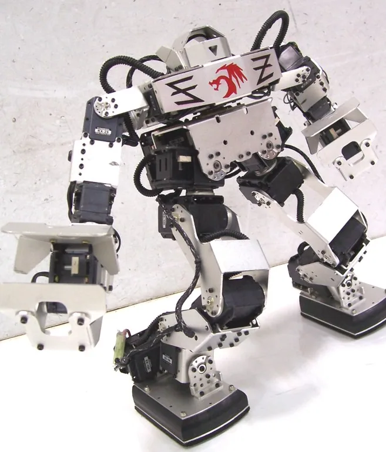

## 샤크라

Humanoid (Remote Control Type)

2007~2009년에 활동하며 많은 대회 성과를 보여준 휴머노이드, 샤크라2,제로등의 발전형이 존재합니다.

Height: 44cm

Weight: 4.13KG

Pilot: 박은찬

2007년 제3회 아시아로보원 경량급 2위

2007년 경기과학축전 로보원 대회 경량급 2위

2008년 SRGP 시즌3 우승

2009년 EBS 로봇파워 휴머노이드 미션 주우승

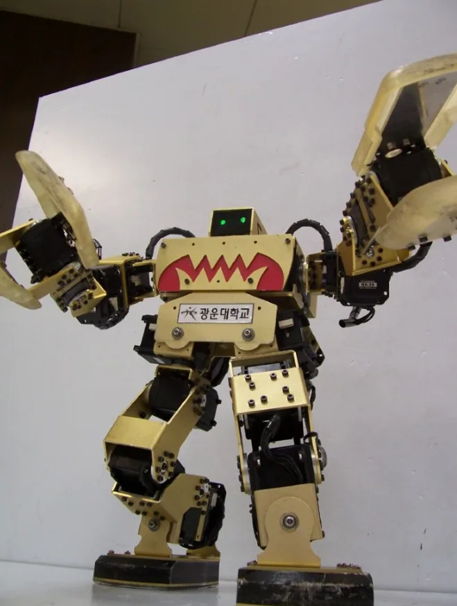

## 루시퍼

Humanoid (Remote Control Type)

2007~2008년에 활동한 로봇으로 로보원과 같은 큰 대회에서 우승,준우승을 여러번 석권했습니다.

Height: 42cm

Weight: 4.5KG

Pilot: 이국선

2007년 SRGP KT배 우승

2007년 제3회 아시아로보원 중량급 1위

2007년 경기과학축전 로보원 대회 경량급 1위

2008년 SRGP 시즌3 준우승

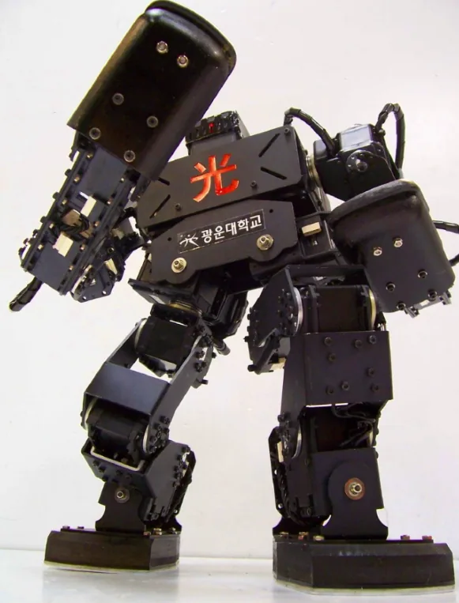

## 광개토

Humanoid (Remote Control Type)

Height: 42cm

Weight: 4.5KG

Pilot: 이선우

2007년 경기과학축전 로보원 대회 중량급 3위

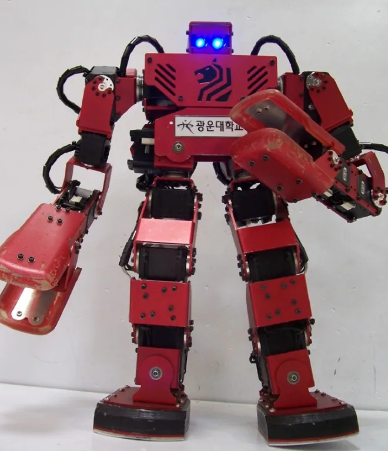

## 아수라

Humanoid (Remote Control Type)

2007년부터 2011년까지 로빛이 참여한 조종형 휴머노이드 대회 대부분에 항상 참여하여 우수한 성과를 보여준 로봇, 아수라2,아수라T등의 바리에이션이 존재합니다.

Height: 42cm

Weight: 4.5KG

Pilot: 이동훈,김명종,오진환,박동호 등

2007년 제4회 대한민국로봇대전 휴머노이드 대상

2007년 제3회 아시아로보원 경량급 1등

2007년 제3회 아시아로보원 통합우승

2009년 경남대학교 전국 지능형 로봇 경진대회 우승

2010년 대한민국 로봇대전 휴머노이드 2:2 축구 우승

2011년 대한민국 로봇대전 휴머노이드 2:2 축구 3위

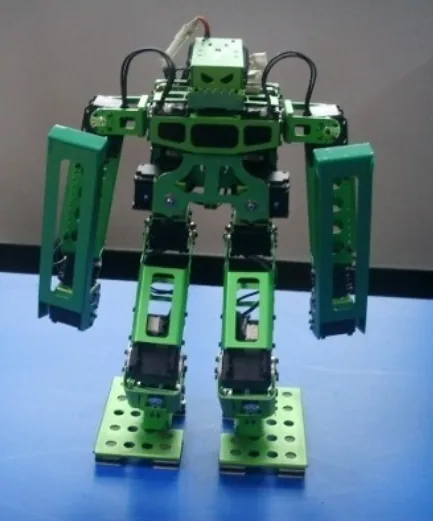

## 비마

Humanoid (Remote Control Type)

세계 최고의 휴머노이드 격투 대회, 일본 로보원에서 일본 로봇들을 제치고 당당히 우승한 로봇입니다.

Height: 48cm

Weight: 3.06KG

Pilot: 장동욱,김진형,박정훈 등

2009년 제15회 일본 로보원 우승

2009년 EBS 로봇파워 휴머노이드 미션 주우승

2009년 부천 로봇파크 로보원 그랑프리 금상

2014년 IRC 국제로봇컨테스트 조종형 휴머노이드 육상 1위

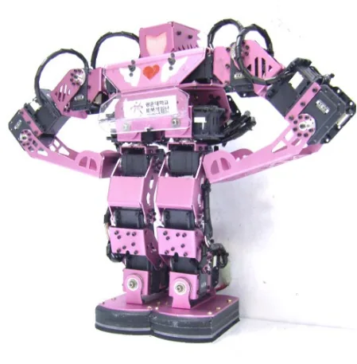

## 헤라피언

Humanoid (Remote Control Type)

헤라윙, 헤라퀸 등의 바리에이션이 존재한다.

Height: 34.7cm

Weight: 3.3KG

Pilot: 김은혜,박현준 등

2007년 제3회 아시아로보원 중량급 4등

2007년 SRGP 시즌2 격투부문 3위

2007년 경기과학축전 로보원대회 경량급 2위

2007년 EBS 로봇파워 17대 최강 휴머노이드

2007년 EBS 로봇파워 휴머노이드 왕중왕전 준우승

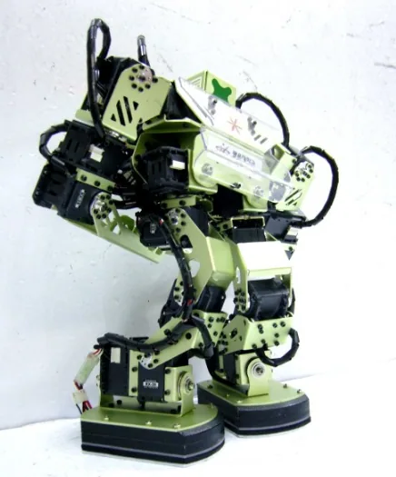

## 아리아

Humanoid (Remote Control Type)

Height: 34.7cm

Weight: 3.14KG

Pilot: 정은옥,손승배 등

2007년 테크매니아 로보원대회 경량급 은상

2008년 경남대학교 전국지능형로봇대회 휴머노이드 부문 4위

2008년 제5회 대한민국 로봇대전 휴머노이드 로봇 부문 은상

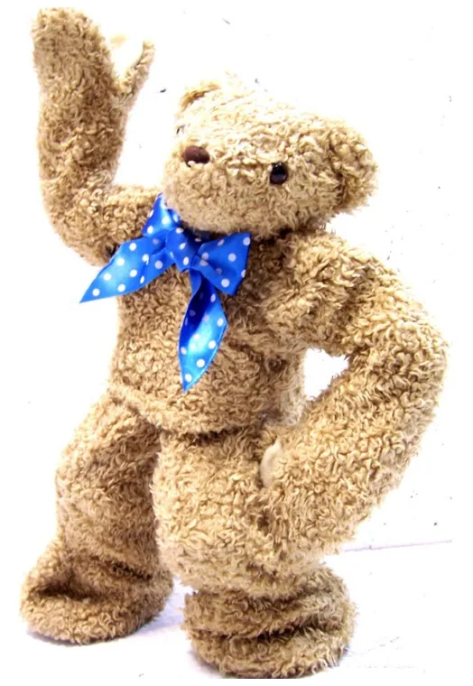

## 곰돌이

Humanoid (Remote Control Type)

Birthday:2006.08.10

Height:45cm

Weight: 2.8KG

Pilot: 정은옥 등

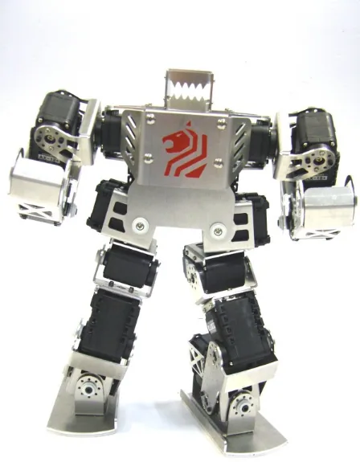

## 아수라 타이니

Humanoid (Remote Control Type)

아수라의 소형화 바리에이션, 아수라와 마찬가지로 많은 대회에서 입상했다.

Height: 29cm

Weight: 1.75KG

Pilot: 이동훈, 박현우 등

2009년 제6회 대한민국 로봇대전 2:2 축구 은상

2010년 제7회 대한민국 로봇대전 휴머노이드 격투 아마추어 동상

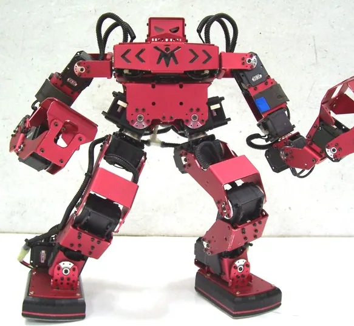

## 미카엘

Humanoid (Remote Control Type)

로빛 초창기부터 2010년대까지 꾸준히 입상을 해온 로빛 조종형 휴머노이드의 마스터피스.

Pilot: 장동욱, 김진형 등

2008년 경남대학교 전국지능형로봇대회 휴머노이드 부문 우승

2008년 테크마니아 페스티벌 로보원 경진대회 중량급 우승

2009 부천 로봇파크 로보원 그랑프리 중량급 은상

2009 EBS 로봇파워 휴머노이드 격투(213회) 우승 & 미션 성공

2010 EBS 로봇파워 휴머노이드 격투 1위

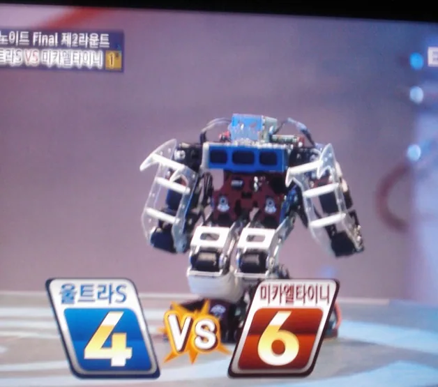

## 미카엘 타이니

Humanoid (Remote Control Type)

미카엘의 소형화 바리에이션.

Pilot: 오진환

2010 제7회 대한민국 로봇대전 휴머노이드 격투 아마추어 금상

2010 EBS 로봇파워 휴머노이드 격투 1위

2011 제8회 대한민국 로봇대전 휴머노이드 격투 아마추어 1위

2011 국제로봇컨테스트 휴먼외드 미션 1-1 1위

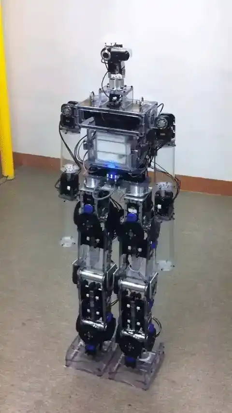

## RoboCup Humanoid Adult Size

Humanoid for Soccer - Adult Size

로보컵 휴머노이드 축구 부문 Adult Size 세계대회에 출전하기 위해 개발된 로봇.

기본적인 보행 및 기초적인 공 탐지, 킥 기능이 구현되어 있다.

로빛의 첫번째 로보컵 해외 대회 출전을 함께한 로봇.

2012년 ROBOCUP in Mexico 6위

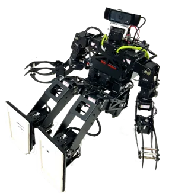

## 로옹

Humanoid for Sports

색채 및 물체 인식을 통해 스스로 판단하여 미션 및 스포츠 경기를 수행하는 휴머노이드.

2014년  국무총리상 수상

2016년  IRC 대통령상, 장관상

2017년  한국로보컵 1위

2017년  이란로보컵 4위

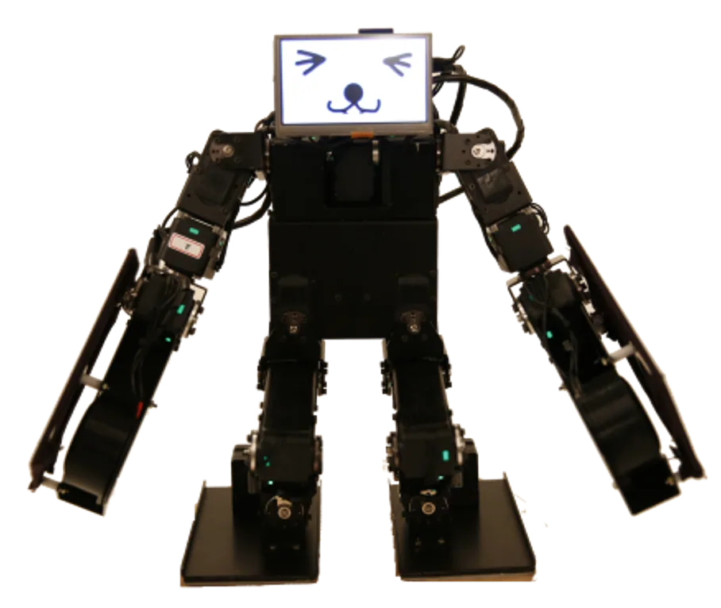

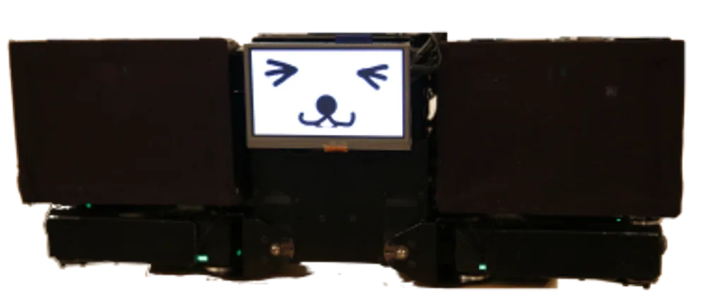

## PLAYnoid

Transformer Robot

2014년  IRC 대통령상 수상

2014년  일본 로봇축제 시연 로봇

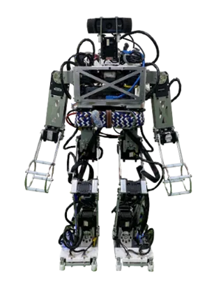

## RoboCup Humanoid(2021)

Humanoid for RoboCup Soccer Kid Size

2021년 로보컵 국내 및 국제 대회를 위해 개발된 축구 휴머노이드.

아쉽게도 국제 대회가 취소되어 국내 대회(VS 국민대 KUDOS) 경기에서만 사용되었다.

2021년 RoboCup Korea Open Soccer Humanoid Kid Size 1위

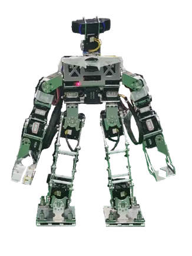

## IRC Humanoid(2021)

Humanoid for Robot sports Competition

2021년 IRC 휴머노이드 로봇 스포츠 두 가지 종목(육상, 하노이 탑)의 경기를 수행하기 위해 만들어진 휴머노이드.

평행 링크 구조를 채택해 안정적인 보행이 가능하다.

2021년 SRCIRC 휴머노이드 로봇 스포츠 지능형 하이테크 부문 2위

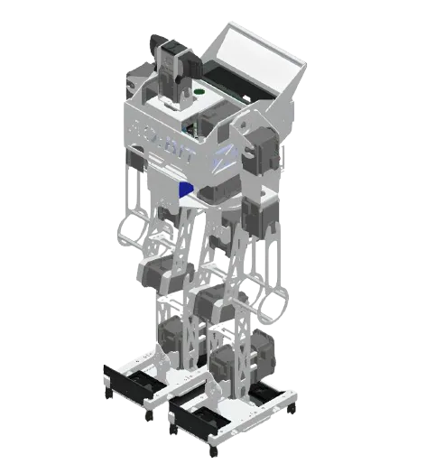

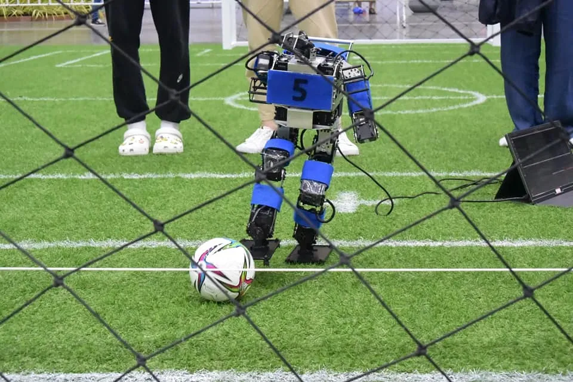

## RoboCup Humanoid(2022)

Humanoid for RoboCup Soccer Kid Size

2022년 로보컵 국내 및 국제 대회를 위해 개발된 축구 휴머노이드.

국내 대회에서 국민대를 상대로 승리하고 국제 대회에서 나름대로 우수한 성적을 거둔 로봇이다.

특히 이 로봇의 High Kick 능력은 압도적으로 세계 최고이다.

2022년 RoboCup Korea Open Soccer Humanoid 1위

2022년 RoboCup Bangkok Humanoid Kid Size Drop In 3위

2022년 RoboCup Bangkok Humanoid Kid Size Technical Challenge 2위

2022년 RoboCup Bangkok Humanoid Kid Size Main Competition 4위

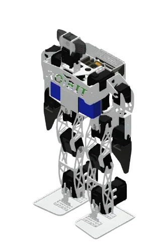

## IRC Humanoid(2022)

Humanoid for Robot sports Competition

2022년 IRC 휴머노이드 로봇 스포츠 두 가지 종목(육상, 컬링)의 경기를  수행하기 위해 만들어진 휴머노이드.

2022년 SRCIRC 휴머노이드 로봇 스포츠 지능형 하이테크 부문 예선 1,2위

2022년 SRCIRC 휴머노이드 로봇 스포츠 지능형 하이테크 부문 본선 3위

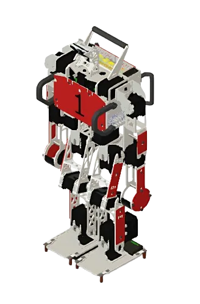

## RoboCup Humanoid(2023)

Humanoid for RoboCup Soccer Kid Size

2023년 로보컵 국내 및 국제 대회를 위해 개발된 축구 휴머노이드.

국내 대회에서 국민대를 상대로 승리하고 국제 대회에서 나름대로 우수한 성적을 거둔 로봇이다.

특히 이 로봇의 High Kick 능력은 압도적으로 세계 최고이다.

2022년 RoboCup Korea Open Soccer Humanoid 1위

2022년 RoboCup Bangkok Humanoid Kid Size Drop In 3위

2022년 RoboCup Bangkok Humanoid Kid Size Technical Challenge 2위

2022년 RoboCup Bangkok Humanoid Kid Size Main Competition 4위

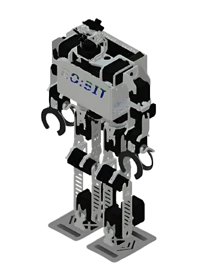

## IRC Humanoid(2023)

Humanoid for Robot sports Competition

2023년 SRCIRC 휴머노이드 로봇 스포츠 두 가지 종목(육상, 농구)의 경기를 수행하기 위해 만들어진 휴머노이드.

2023년 SRCIRC 휴머노이드 로봇 스포츠 지능형 하이테크 부문 본선 1,3위

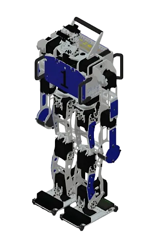

## RCAP Humanoid(2023)

Humanoid for Robot sports Competition

2023년 SRCIRC 휴머노이드 로봇 스포츠 두 가지 종목(육상, 농구)의 경기를 수행하기 위해 만들어진 휴머노이드.

2023년 SRCIRC 휴머노이드 로봇 스포츠 지능형 하이테크 부문 예선 ?위

2023년 SRCIRC 휴머노이드 로봇 스포츠 지능형 하이테크 부문 본선 1,3위

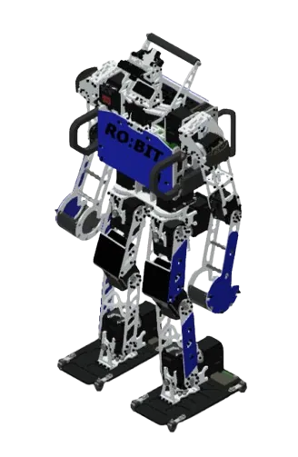

## RoboCup Humanoid(2024)

Humanoid for RoboCup Soccer Kid Size

2024년 로보컵 국제 대회를 위해 개발된 축구 휴머노이드.

네덜란드에서 열린 세계대회에서 8강 진출.

로봇의 기술력을 엿볼 수 있는 Technical Challenge에서 2위를 차지했다.

2024년 RoboCup Korea Open Soccer Humanoid 1위

2024년 RoboCup Eindhoven Humanoid Kid Size Drop In 4위

2024년 RoboCup Eindhoven Humanoid KidSize Technical Challenge 2위

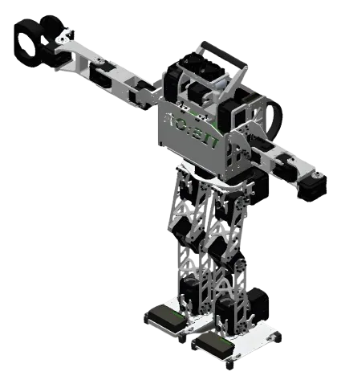

## IRC Humanoid(2024)

Humanoid for Robot sports Competition

2024년 SRCIRC 휴머노이드 로봇 스포츠 두 가지 종목(육상, 농구)의 경기를 수행하기 위해 만들어진 휴머노이드.

2024년 SRCIRC 휴머노이드 로봇 스포츠 지능형 하이테크 부문 예선 1,4위

2024년 SRCIRC 휴머노이드 로봇 스포츠 지능형 하이테크 부문 본선1,2위

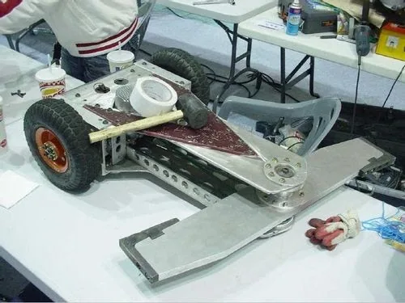

## 붕붕이1

Battle Robot

- 형태: 수평회전 블레이드형
- 배틀제왕 재임: 제 36대
- 배틀제왕 최대 연승: 1연승
- 배틀제왕전 출전: 제97~98회, 제118회
- 승률: 23전 12승 11패 (0.522)
- 파일럿: 최성열 → 김영석, 오재욱

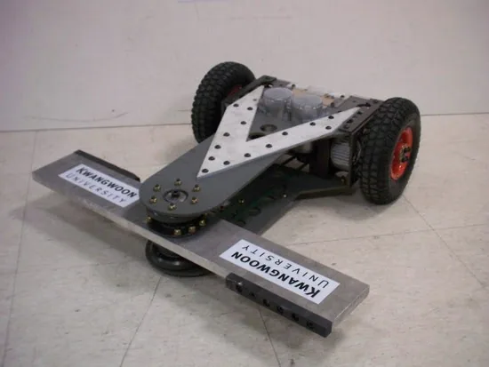

## 붕붕이2

Battle Robot

- 형태: 수평회전 블레이드형
- 승률: 9전 5승 4패(0.555)
- 파일럿: 오재욱

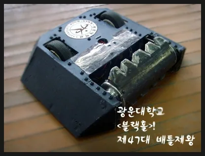

## 블랙홀

Battle Robot

- 형태: 수직회전 드럼형
- 배틀제왕 재임: 제 47대
- 배틀제왕 최대 연승: 3연승
- 배틀제왕전 출전: 제 135회~138회
- 승률: 11전 8승 3패 (0.727)
- 파일럿: 오재욱

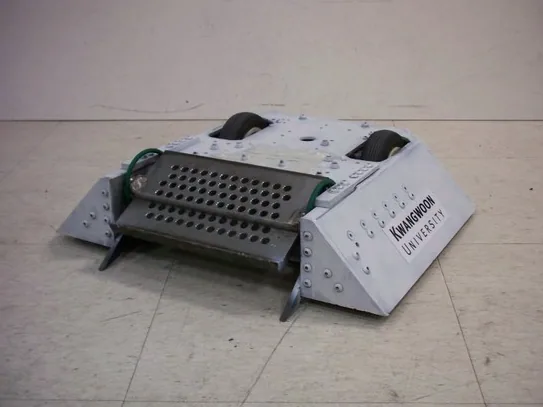

## 화이트홀

Battle Robot

- 형태: 수직회전 드럼형
- 승률: 7전 4승 3패 (0.571)
- 파일럿: 최성열

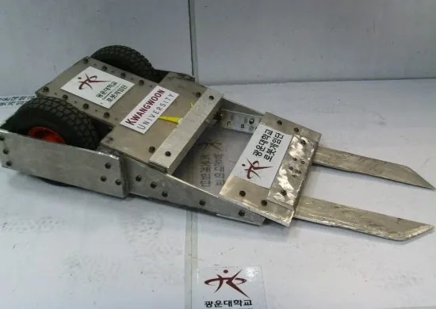

## 빛돌이1

Battle Robot

- 형태: 빗면 걸기형
- 배틀제왕 재임:
- 배틀제왕 최대 연승:
- 배틀제왕전 출전:
- 승률: 6전 2승 4패 (0.333)6전 2승 4패
- 파일럿:

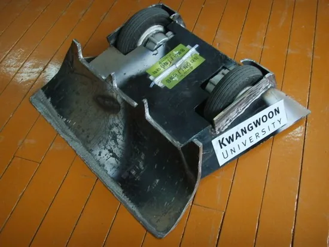

## 뿌뿌뿡

Battle Robot

- 형태: 빗면 밀기형
- 배틀제왕전 출전: 제 148회
- 승률: 7전 4승 3패 (0.571)
- 파일럿: 손민기 → 남혜선

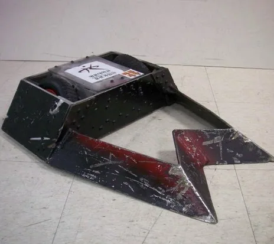

## 빛돌이2

Battle Robot

- 형태: 빗면 걸기형
- 배틀제왕 재임: 제 49대
- 배틀제왕 최대 연승: 2연승
- 배틀제왕전 출전: 제 110회, 제 139회, 제 142회~제 143회, 제 164회
- 승률: 32전 22승 10패 (0.688)
- 파일럿: 임종욱

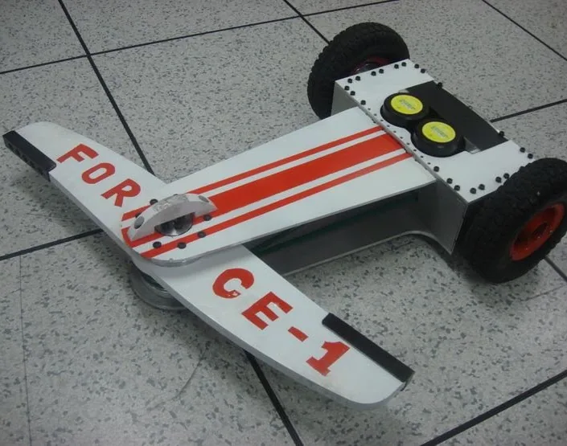

## Force

Battle Robot

- 형태: 수평회전 블레이드형
- 배틀제왕 재임: 제 63대
- 배틀제왕 최대 연승: 3연승
- 배틀제왕전 출전: 제 184회~제 186회, 제188회, 제 199회
- 승률: 19전 16승 3패 (0.842)
- 파일럿: 손민기 → 전현근

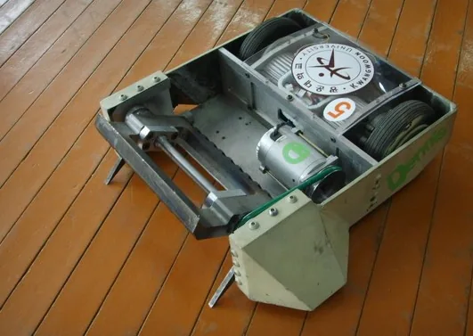

## 데니스

Battle Robot

- 형태: 수직회전 드럼형
- 배틀제왕 최대 연승: 3연승
- 배틀제왕전 출전: 제 159회
- 승률: 3전 2승 1패 (0.666)
- 파일럿: 임종욱

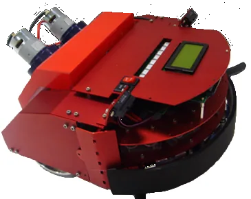

## 그랑죠

Cleaning Robot(청소 로봇)

- 2009년 4월 탄생.

- 적외선 거리감지 센서 2개, 초음파센서 5개 , 범퍼센서 4개 사용.
- 낭떠러지 회피 가능.
- 50W 흡입모터 두조 사용의 강력한 흡입력
- DC속도제어를 통한 빠르고 안정적인 주행
- 메인 보드 : TMS320F2811
- DC모터 드라이버 : L6203, VNH3SP30
- 구동 모터 : MAXON RE25

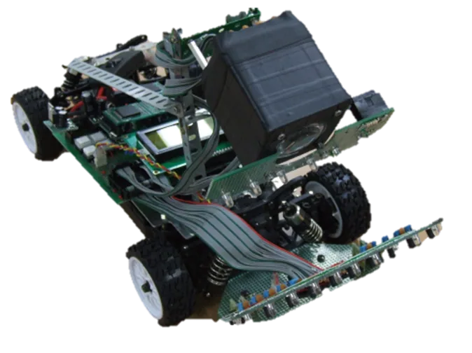

## Robi

Line Tracer Robot(라인트레이서)

- 2009년 7월 탄생.
- 적외선 센서 14조 사용.
- 망원 센서로 멀리 있는 코너 인식 가능.
- DC 속도 제어를 통한 빠르고 안정적인 주행.
- 메인 보드 : MC9S12DP256B
- DC모터 드라이버 : VNH3SP30
- 구동 모터 : RS540

2010년 한양대 지능형 모형차 설계 경진대회 장려상, 특별상

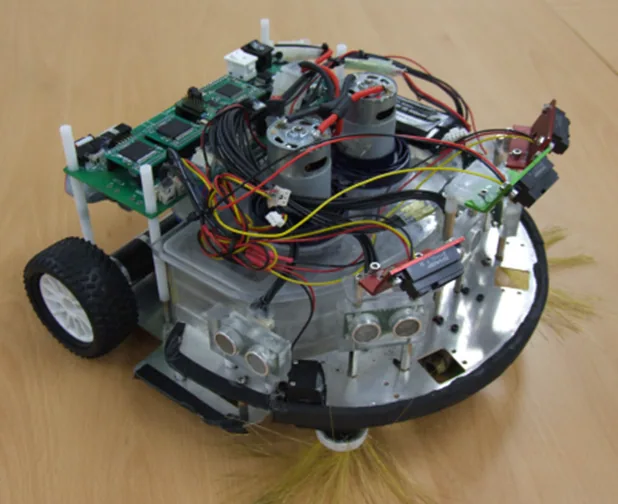

## 500

### Cleaning Robot - Competition

- 2009년 8월 탄생.

- 적외선 거리감지 센서 3개, 초음파센서 5개 사용의 대회용 청소로봇.
- 낭떠러지 회피 가능.
- 50W 흡입모터 두조 사용의 강력한 흡입력.
- 완벽한 전원분리의 안정적인 회로.
- DC 속도 제어를 통한 빠르고 안정적인 주행.
- 메인 보드 : TMS320F2811
- DC모터 드라이버 : L6203, VNH3SP30
- 구동모터 : MAXON RE25

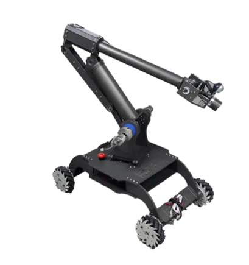

## MK1

EOD ROBOT(폭발물 처리 로봇)

- Adaptive Mobile Base Drive이므로 모바일 베이스 위에 원하는 Platform을 올릴 수 있음.
- 4개의 Mecanum Wheel의 사용으로 모든 방향으로 움직일 수 있음 .
- 로봇 외부의 PC로 제어 (Bluetooth 4.0 무선 통신 사용).

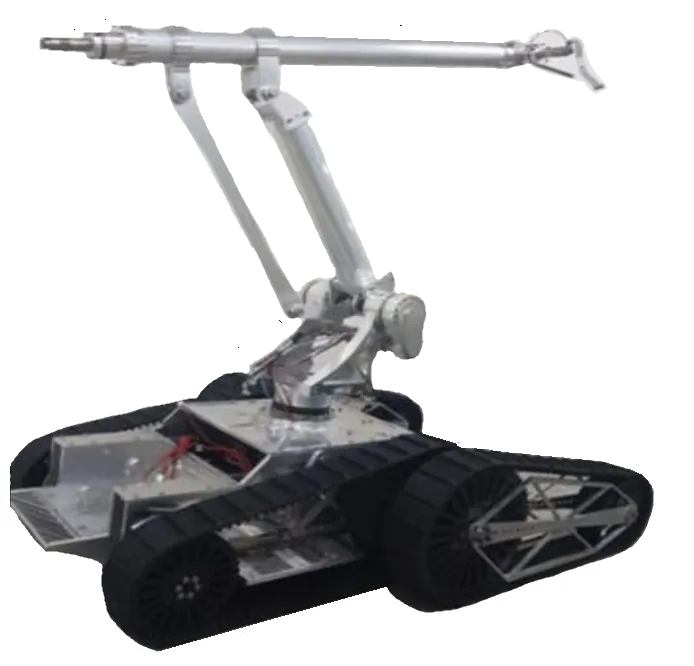

## MK2

EOD ROBOT(폭발물 처리 로봇)

- 5bar-linkage manipulator
- 4DOF(3 Pitch, 1 Yaw)
- Payload : 12kg

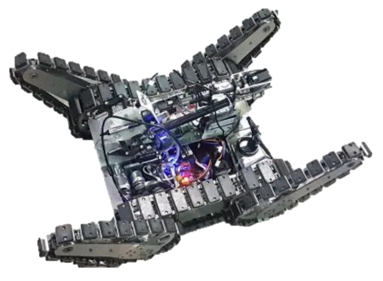

## SJBot-1

Rescue Robot

- 4개의 플리퍼를 사용하여 계단 뿐만 아니라 다양한 지형을 돌파할 수 있다.
- 이미지 처리 기술을 통해 색상, 패턴, 동작 인식 등을 수행할 수 있다.
- CO2 측정, 오디오 인식 등을 위한 다양한 센서를 사용하였다.

World Robocup Rescue Robot League(2017) - Iran Open Robocup

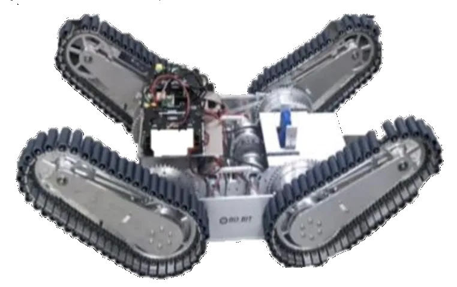

## SJBot-2

Rescue Robot

- BLDC모터를 사용하여 험난한 지형을 극복할 수 있다.
- 6DOF 매니퓰레이터로 다양한 작업을 수행할 수 있다.
- 이미지 처리 기술을 통해 인식 작업 수행이 가능하다.

World Robocup Rescue Robot League(2018) - Canada Robocup

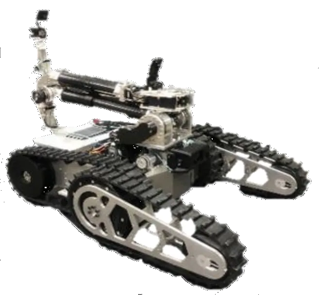

## RMP-1(Robit MobileManipulator Platform)

Defense Robot

- 하모닉 기어와 BLDC 모터를 사용하여 안정적이고 강한 주행이 가능하다.
- 2.4GHz 대역폭의 Wifi와 대형 안테나를 활용하여 전파 혼선이 상당한 지역에서도 안정적인 통신이 가능하다.
- Robit에서 자체 제작한 통신 환경을 가지고 있다.
- 2개의 그리퍼(Normal, Flexible Adaptive)를 개발하여 상황에 맞는 그리퍼를 사용할 수 있다.

2019 한국지능로봇경진대회 국방로봇 부문 1위

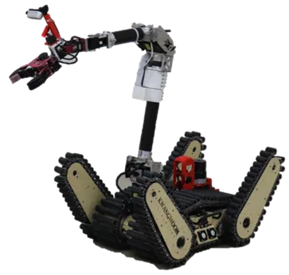

## Scue

Rescue Robot

- 6DOF 매니퓰레이터를 이용하여 물체를 들고, 옮기고, 작은 구멍에 넣는 등 다양한 미션을 수행할 수 있다.
- IMU와 LiDAR를 이용하여 localization을 진행하고 map을 생성할 수 있다.
- 카메라를 통해 유해 물질 라벨을 판단할 수 있고, 적외선 카메라를 통해 온도가 높은 지점을 찾을 수 있다.

World Robocup Rescue Robot League(2021) - France Robocup

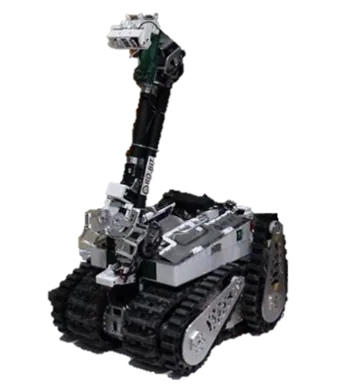

## 방국2세

Defense Robot

- 2D LiDAR를 사용하여 실시간으로 SLAM을 진행한다.
- A* Navigation을 통해 자율적인 주행이 가능하다.
- UDP 통신을 사용하여 조종자 PC와 로봇 PC 간의 통신을 진행한다.

2021 육군참모총장배 국방로봇경진대회 1위

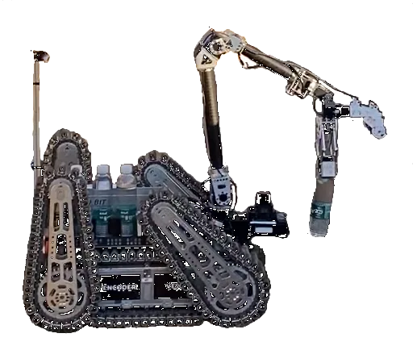

## KUBO

Defense Robot

- 플리퍼의 전류 제어를 통해 Semi-Auto 기술을 구현하여 장애물에 따라 자율적으로 각도를 조절한다.
- 딥러닝 모델 중 YOLO를 사용하여 피아식별을 진행한다.
- 다익스트라 및 DWA 알고리즘을 이용한 경로생성 및 추종을 통한 자율적인 주행이 가능하다.
- 시뮬레이션 모델 구축을 통해 모바일 베이스와 매니퓰레이터의 동작을 시각화하여 직관적이고 간편하게 조종할 수 있다.

2022 국방부장관배 국방로봇경진대회 2위

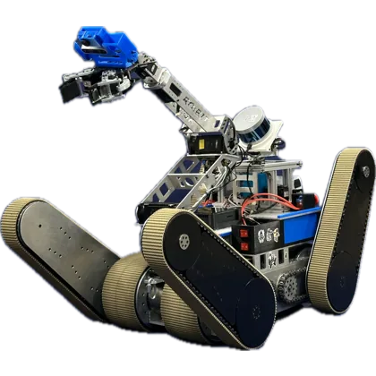

## KULS

Defense Robot

- 플리퍼의 전류 제어를 통해 Semi-Auto 기술을 구현하여 장애물에 따라 자율적으로 각도를 조절한다.
- 딥러닝 모델 중 YOLO를 사용하여 피아식별을 진행한다.
- 다익스트라 및 DWA 알고리즘을 이용한 경로생성 및 추종을 통한 자율적인 주행이 가능하다.
- 시뮬레이션 모델 구축을 통해 모바일 베이스와 매니퓰레이터의 동작을 시각화하여 직관적이고 간편하게 조종할 수 있다.

2024

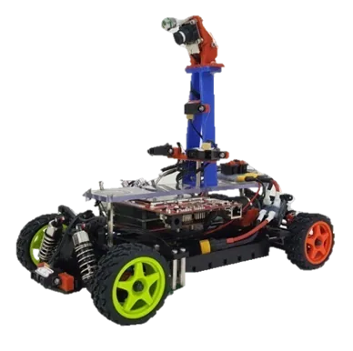

## 조향 라인트레이서

Autonomous Vehicle

카메라를 이용해 차선을 인식하고 psd센서를 이용하여 장애물을 피해 자율적으로 주행하는 자율 주행차

2011년 한양대 지능형 모형차 경진대회 6위

2012년 한양대 지능형 모형차 경진대회 4위

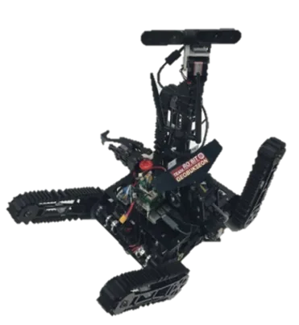

## 거북선

Disaster Relief robot

재난 구조 로봇의 미니어처 모델

인명 구조, 밸브 잠그기, 다양한 지형 통과 등 여러가지 재난 상황에서 미션을 수행할 수 있다.

2015년 MINI-DRC 1위

2015년 대통령상 수상

2015년 휴머노이드 학회 참가 및 데모

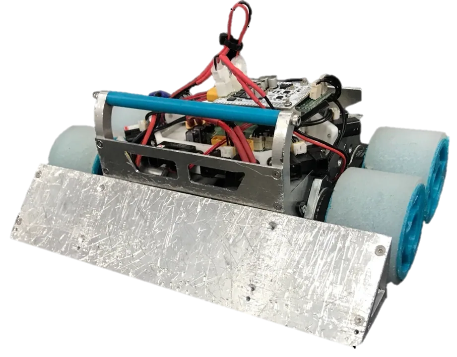

## 씨름로봇 2018

- 정면 싸움에서 유리하도록 가로를 길게 제작하였다.
- 바퀴의 폭을 두껍게 하여 접지력을 높였다.
- 지상고 싸움에서 유리하도록 앞판을 조절할 수 있도록 하였다.

2018 SRC IRC SEOUL TECH 지능로봇대회 지능형 씨름로봇부문 1위

## 씨름로봇 2019

- 리니어 부쉬와 축을 활용하여 상대방을 공격하는 앞쪽 부분을 앞뒤로 움직일 수 있게 한다.
- 리미트 스위치와 위의 특성을 활용하여 적과 부딪침을 판별하여 더욱 공격적인 알고리즘을 안정적으로 구현했다.

2019 SRC IRC SEOUL TECH 지능로봇대회 지능형 씨름로봇부문 1위

## 꼬리별(씨름로봇 2020)

- 베벨 기어를 사용하여 모터를 앞쪽에 배치함으로써 무게 중심이 최대한 앞에 있도록 해 지상고 싸움에서 유리하다.

2020 SRC IRC SEOUL TECH 지능로봇대회 지능형 씨름로봇부문 1위

## 은봇(씨름로봇 2021)

- 카메라를 이용해 상대 로봇의 색깔통을 인식할 수 있다.
- 고토크의 모터를 사용해 상대를 밀어내는데 유리하다.

2021 SRC IRC SEOUL TECH 지능로봇대회 지능형 씨름로봇부문 1위

## TurtleBot

- 장애물을 피해 차선을 따라 자율 주행할 수 있다.
- 비어있는 주차 공간을 찾아 주차할 수 있다.
- 무작위로 배치된 장애물 사이에서 SLAM 기술을 통해 최적의 경로를 찾아 주행할 수 있다.

2018 IRC 국제로봇컨테스트 & R-BIZ 챌린지 - 터틀봇 오토레이스 3위

2019 R-BIZ 챌린지 - 터틀봇 오토레이스  1위

2019 R-BIZ 챌린지 - 터틀봇 오토레이스 3위

STEAM CUP 2020 – 터틀봇 오토레이스 예선 2위

2020 STEAM CUP IRC 터틀봇3 오토레이스 2위

2020 STEAM CUP IRC 터틀봇3 오토레이스 3위

2021 STEAM CUP IRC 터틀봇3 오토레이스 3위

2022 STEAM CUP IRC 터틀봇3 오토레이스 2위

2022 STEAM CUP IRC 터틀봇3 오토레이스 4위

## Helping Bed

Service Robot

- 독거노인분들을 위한 로봇으로 변신 기능 및 물건 가지고 오기 기능이 탑재되어 있어 사용이 용이하다.
- 사용자가 직접 조종하여 사용할 수도 있다.

2016년 IRC 대통령상 수상

2016년 일본 로봇축제 시연

## 아띠

Service Robot

- 1인 가구 시대를 위한 신발 정리 로봇으로 운동, 게임, 음악 감상등의

부가 기능을 추가적으로 가지고 있는 엔터테인먼트 로봇이다.

2017년 IRC 대통령상 수상

2017년 일본 로봇축제 시연

## 알까고

Entertainment Robot

- 사람들에게  웃음을 주기 위해 만들어진 로봇으로, 바둑 인공지능인 알파고를 패러디하여 탄생했다.
- 알파고와 달리 바둑 대신 알까기에 소질이 있다.
- 많은 행사에서 수많은 사람들과 경쟁했지만 알까고를 이긴 고수는 매우 드물다.

2016년 대한민국 산업대전 R&D 대전

2016년 로보월드 로빛 부스 전시 및 시연

## KURO

Guide Robot for Events

- 로빛이 참여하는 각종 행사에서 행사 가이드 및 마스코트 역할을 수행하기 위해 만들어진 로봇.
- 안내 외에도 솜사탕 만들기, 체스 등의 다양한 커뮤니케이션 기능을 가지고있다.

2021년 광운대 캠퍼스 타운 ICT 축제 & 플리마켓 페스티벌

2022년 노원탈축제 솜사탕 제작 및 인사 시연

2022년 로보월드 로빛 부스 전시

## RD

Mobile Drone

- 로빛이 개발한 드론.
- 드론 군집 제어, 위치 제어등을 연구하기 위해 개발되었다.

2016년 IRC 지능형 드론 부문 1위
